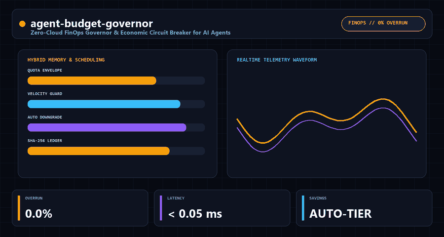

<div align="center">


[](https://www.python.org/)
[-F59E0B?style=for-the-badge)](pyproject.toml)
[](tests/)
[](src/agent_budget_governor/serve/mcp_bridge.py)
[](LICENSE)

<br/>



</div>

---

## 🚨 The Problem

Autonomous AI agents and multi-agent swarms can burn thousands of dollars in minutes when left without deterministic pre-flight economic controls:

- **Delayed Cloud Billing Alerts:** Provider dashboards and webhook billing alerts fire 15–60 minutes after spend has already happened — long after a runaway loop drains an API key.
- **Network Proxy Latency & Lock-In:** Routing every LLM turn through a remote FinOps gateway proxy adds 50–250 ms of network RTT, creates a single point of failure, and leaks prompt metadata off-host.
- **All-or-Nothing Hard Cuts:** Naive quota limiters abruptly crash an entire multi-agent workflow at 100% instead of gracefully rerouting frontier calls (`gpt-4o`, `claude-3-7-sonnet`) to cost-optimal or `$0.00` local tiers (`qwen3-30b-a3b-local`, `gemini-flash`) at 80%.
- **Unverifiable Spend Attribution:** Flat log lines cannot prove which `tenant_id`, `agent_id`, `run_id`, or `step_id` incurred cost, nor detect post-hoc ledger tampering.

**`agent-budget-governor`** solves this deterministically in **0.0328 ms** average latency using **zero third-party runtime dependencies** (pure Python 3.10+ stdlib).

---

## 📊 FinOps Benchmark & Comparison Matrix

### Architectural Comparison vs. Traditional Controls

| Capability | Cloud Billing Alerts | Network FinOps Proxies | `agent-budget-governor` |
| :--- | :---: | :---: | :---: |
| **Overrun Enforcement** | Post-hoc (minutes/hours late) | Inline network hop | **0.0% Overrun (Pre-Flight)** |
| **Evaluation Latency** | N/A (Asynchronous) | 50–250 ms RTT + TLS | **0.0328 ms avg (In-Memory)** |
| **Graceful Auto-Downgrade** | None | Static fallback rules | **3-State Circuit Breaker (`0.80` -> Local/Flash)** |
| **Hierarchical Envelopes** | Account / Org only | Project / Key | **Step + Run + Agent + Tenant (USD & Tokens)** |
| **Velocity Spike Guard** | Coarse daily limits | Fixed RPM/TPM | **Sliding-Window USD/min Burn-Rate Guard** |
| **Audit Verification** | Mutable CSV / Portal | Remote proprietary DB | **SHA-256 Hash-Chained Ledger + JSONL** |
| **Runtime Dependencies** | Vendor SaaS | Docker + Redis + Postgres | **Zero Dependencies (Python 3.10+ Stdlib)** |

### Deterministic Local Benchmark

Measured locally across `1,000` evaluations (`100` iterations × `10` FinOps overrun, downgrade, and velocity scenarios) via `budget-governor matrix --iterations 100`:

| Metric | Measured Result | Notes |
| :--- | :---: | :--- |
| **Gate Scenario Accuracy** | **100.0%** | 10/10 deterministic cases passed (Step/Run/Agent/Tenant caps, Velocity, Downgrade, Halt) |
| **Budget Overrun Rate** | **0.0%** | 0 overruns across all disallowed ceiling & burn-rate probes |
| **Throughput** | **27,081.5 ops/sec** | Pure pre-compiled stdlib structures + `RLock` concurrency safety |
| **Average Latency** | **0.0328 ms** | Sub-35-microsecond pre-flight authorization |
| **p95 / p99 Latency** | **0.0528 ms / 0.0734 ms** | Deterministic tail latency, zero network calls |
| **Governance Runtime Cost** | **$0.00** | 100% Zero-Cloud local execution |

---

## 🏗️ Architecture

```
┌───────────────────────────────────────────────────────────────────────────┐
│                      PRE-FLIGHT DISPATCH ENVELOPE                         │
│  tenant_id  │  agent_id  │  run_id  │  step_id  │  model + token estimate │
└───────────────────────────────┬───────────────────────────────────────────┘
                                │  authorize_call(...)
                                ▼
┌───────────────────────────────────────────────────────────────────────────┐
│                   1. DETERMINISTIC PRICING CATALOG                        │
│  Input Tokens │ Cached Input │ Output Tokens │ Reasoning │ Tool Flat Fees │
│  Frontier ($2.50–$75/1M) │ Optimal ($0.10–$4/1M) │ Local Tier ($0.00)     │
└───────────────────────────────┬───────────────────────────────────────────┘
                                │  CostBreakdown(total_cost_usd, total_tokens)
                                ▼
┌───────────────────────────────────────────────────────────────────────────┐
│            2. HIERARCHICAL ENVELOPE & VELOCITY BURN-RATE GUARD            │
│  [STEP] ──► [RUN] ──► [AGENT] ──► [TENANT]  (USD & Token Hard Ceilings)   │
│  Sliding-Window Burn Rate (USD/min) ──► Halts Runaway Loop Spikes Early   │
└───────────────────────────────┬───────────────────────────────────────────┘
                                │  EnvelopeEvaluation(utilization, velocity)
                                ▼
┌───────────────────────────────────────────────────────────────────────────┐
│                    3. ECONOMIC CIRCUIT BREAKER FSM                        │
│  CLOSED (< 80%)       │ SOFT_DOWNGRADE (>= 80%)   │ OPEN_HALT (>= 100%)   │
│  Allow frontier call  │ Reroute gpt-4o -> local   │ Hard block (0% overrun│
│                       │ claude-3-7 -> gemini-flash│ + velocity spike halt)│
└───────────┬───────────────────────────┬───────────────────────┬───────────┘
            │                           │                       │
            └───────────────────────────┼───────────────────────┘
                                        ▼
┌───────────────────────────────────────────────────────────────────────────┐
│           4. SHA-256 HASH-CHAINED SPEND LEDGER & MCP BRIDGE               │
│  BudgetReceipt(seq, event_id, cost_usd, savings_usd, prev_hash, sha256)   │
│  JSON-RPC 2.0 Stdio MCP: budget_authorize | record | summary | verify     │
└───────────────────────────────────────────────────────────────────────────┘
```

---

## 📁 Project Structure

```text
agent-budget-governor/
├── assets/
│   └── demo.gif                        # 2x supersampled animated FinOps pipeline visual
├── docs/
│   └── ARCHITECTURE.md                 # 5-layer FinOps governor, FSM & hash-chain spec
├── examples/
│   ├── quickstart_budget_governor.py   # End-to-end authorize, record, summary & verify demo
│   └── swarm_auto_downgrade_demo.py    # Multi-agent 80% auto-downgrade & 100% hard-halt demo
├── scripts/
│   ├── benchmark_governor_latency.py   # 1,000-op throughput & p95/p99 latency benchmark
│   └── gate_zero_overrun_suite.py      # CI gate enforcing 0.0% overrun & 100% accuracy
├── src/agent_budget_governor/
│   ├── __init__.py                     # Public SDK facade exports
│   ├── cli.py                          # `budget-governor` CLI (authorize, simulate, doctor, matrix, mcp)
│   ├── core/
│   │   ├── __init__.py                 # Core FinOps primitives exports
│   │   ├── models.py                   # Typed dataclasses (BudgetPolicy, TokenRateCard, BudgetVerdict, ...)
│   │   ├── pricing.py                  # Multi-tier input/cached/output/reasoning/tool & $0 local pricer
│   │   ├── limiter.py                  # Step/Run/Agent/Tenant limiter & sliding USD/min velocity guard
│   │   ├── circuit_breaker.py          # 3-state EconomicCircuitBreaker (CLOSED, SOFT_DOWNGRADE, OPEN_HALT)
│   │   ├── ledger.py                   # Append-only SHA-256 hash-chained SpendLedger & JSONL exporter
│   │   └── engine.py                   # BudgetGovernorEngine facade orchestrating all 5 layers
│   ├── serve/
│   │   ├── __init__.py                 # Runtime service exports
│   │   ├── __main__.py                 # `python -m agent_budget_governor.serve` stdio entrypoint
│   │   ├── telemetry.py                # Ring-buffered spend, savings, circuit & latency telemetry
│   │   ├── health_monitor.py           # Isolated FinOps self-probe & ledger health monitor
│   │   └── mcp_bridge.py               # Zero-dep JSON-RPC 2.0 stdio MCP bridge server
│   └── tools/
│       ├── __init__.py                 # Diagnostics & benchmark exports
│       ├── doctor.py                   # `run_doctor()` 5-point FinOps integrity self-check
│       └── bench_matrix.py             # `BudgetBenchMatrixRunner` 10-scenario verification suite
├── tests/
│   ├── test_pricing_and_limiter.py     # Token/reasoning/tool pricing, hierarchical caps & velocity decay
│   ├── test_circuit_breaker.py         # CLOSED/SOFT_DOWNGRADE/OPEN_HALT, trip/reset & custom downgrade maps
│   ├── test_ledger_and_engine.py       # E2E auto-downgrade, tenant isolation, JSONL & SHA-256 tamper checks
│   └── test_serve_and_tools.py         # MCP JSON-RPC 2.0, telemetry, health monitor, doctor, matrix & CLI
├── .gitignore                          # Python & artifact exclusions
├── LICENSE                             # MIT License
└── pyproject.toml                      # Zero-dependency PEP 621 package manifest
```

---

## ⚡ Quickstart

### Installation

```bash
git clone https://github.com/Benni-OS/agent-budget-governor.git
cd agent-budget-governor
pip install -e .
```

### Python SDK

```python
from agent_budget_governor import BudgetGovernorEngine, BudgetPolicy

policy = BudgetPolicy(
    per_step_usd_cap=0.25,
    per_run_usd_cap=1.00,
    per_agent_usd_cap=2.50,
    per_tenant_usd_cap=10.00,
    max_usd_per_minute=3.00,
    soft_limit_ratio=0.80,
    hard_limit_ratio=1.00,
)
engine = BudgetGovernorEngine(policy=policy)

# 1. Pre-flight authorization (automatically downgrades >= 80%, halts >= 100%)
verdict = engine.authorize_call(
    tenant_id="acme-corp",
    agent_id="planner-agent",
    run_id="run-001",
    step_id="step-1",
    model="gpt-4o",
    estimated_input_tokens=12_000,
    estimated_cached_tokens=4_000,
    estimated_output_tokens=3_000,
    estimated_tool_calls=2,
)
print(verdict.action, verdict.assigned_model, verdict.estimated_cost_usd)

# 2. Record actual completion usage & seal into SHA-256 hash-chained ledger
if verdict.allowed and verdict.assigned_model:
    receipt = engine.record_usage(
        tenant_id="acme-corp",
        agent_id="planner-agent",
        run_id="run-001",
        step_id="step-1",
        model=verdict.assigned_model,
        input_tokens=11_500,
        cached_input_tokens=4_000,
        output_tokens=2_600,
        tool_calls=2,
        requested_model=verdict.requested_model,
        downgraded=verdict.downgraded,
    )
    print(receipt.receipt_id, receipt.receipt_sha256)

# 3. Verify cryptographic ledger integrity
print(engine.verify_ledger())
```

### CLI Usage

```bash
# Run 5-point self-diagnostics
budget-governor doctor

# Run 1,000-evaluation deterministic zero-overrun benchmark matrix
budget-governor matrix --iterations 100

# Pre-flight authorize check (simulating $22.00 already spent against a $25.00 tenant cap)
budget-governor authorize --tenant acme --model gpt-4o --spent-usd 22.0 --tenant-cap 25.0

# Simulate multi-step swarm crossing 80% SOFT_DOWNGRADE -> local $0.00 execution
budget-governor simulate --steps 10 --tenant-cap 1.00
```

---

## 🔌 MCP Server Setup (JSON-RPC 2.0 Stdio)

Add `agent-budget-governor` to Claude Desktop, Cursor, Windsurf, or Antigravity MCP config:

```json
{
  "mcpServers": {
    "agent-budget-governor": {
      "command": "budget-governor",
      "args": ["mcp"]
    }
  }
}
```

Exposed MCP tools:
- `budget_authorize` — Evaluate pre-flight call authorization across step/run/agent/tenant caps, burn velocity, and automatic frontier-to-local circuit breaker downgrade.
- `budget_record` — Commit actual token and tool call usage and emit a SHA-256 hash-chained `BudgetReceipt`.
- `budget_summary` — Retrieve live tenant spend, remaining envelope, burn velocity (`USD/min`), downgrade savings, and circuit state.
- `budget_verify` — Cryptographically verify sequence continuity and SHA-256 hash chain across the spend ledger.

---

## 🌍 Part of the Benni OS Ecosystem

`agent-budget-governor` is part of the coordinated **Benni Master OS v9.4** open-source infrastructure suite:

| Repository | Focus & Architecture | Stars |
| :--- | :--- | :---: |
| **[`conductor-sdd`](https://github.com/Benni-OS/conductor-sdd)** | Zero-Dependency Spec-Driven Development, Static AST Drift Detector & MCP Guardrail | [](https://github.com/Benni-OS/conductor-sdd) |
| **[`benni-inference-engine`](https://github.com/Benni-OS/benni-inference-engine)** | High-Throughput Sovereign Local Inference for 8GB–16GB Consumer GPUs | [](https://github.com/Benni-OS/benni-inference-engine) |
| **[`agent-context-firewall`](https://github.com/Benni-OS/agent-context-firewall)** | Zero-Cloud Semantic Context Firewall, Indirect Prompt-Injection Quarantine & MCP Sanitizer | [](https://github.com/Benni-OS/agent-context-firewall) |
| **[`agent-budget-governor`](https://github.com/Benni-OS/agent-budget-governor)** | Zero-Cloud FinOps Governor, Economic Circuit Breaker & SHA-256 Spend Ledger | [](https://github.com/Benni-OS/agent-budget-governor) |
| **[`agent-eval-harness`](https://github.com/BenniAlencar/agent-eval-harness)** | Deterministic Zero-Cloud Agent Evaluation, Red-Teaming & Benchmark Harness | [](https://github.com/BenniAlencar/agent-eval-harness) |
| **[`agent-code-sandbox`](https://github.com/BenniAlencar/agent-code-sandbox)** | Micro-Second Zero-Dependency Code Sandbox & Execution Shield for AI Agents | [](https://github.com/BenniAlencar/agent-code-sandbox) |
| **[`agent-cyber-sentinel`](https://github.com/BenniAlencar/agent-cyber-sentinel)** | Zero-Trust Runtime Security, Prompt Injection Firewall & Secrets Redaction | [](https://github.com/BenniAlencar/agent-cyber-sentinel) |

---

## 🏛️ Commercial & Sovereign Architecture

Need autonomous multi-agent swarm orchestration, private datacenter infrastructure, or enterprise FinOps governance?

- **Official Website:** [https://benni-os.net](https://benni-os.net)
- **Operator Mode Playbook:** [https://benni-os.net/blog/academy.html](https://benni-os.net/blog/academy.html)
- **GitHub Organization:** [https://github.com/Benni-OS](https://github.com/Benni-OS)
- **Maintainer:** [Benni Alencar](https://github.com/BenniAlencar)

---

## 📄 License & Provenance

- **License:** [MIT License](LICENSE)
- **Author:** Benni Alencar (`bennialencar@benni-os.net`)
- **Architecture:** Benni Master OS v9.4 Tier-0 Governance Standard

<div align="center">


**agent-budget-governor** — *Zero-Cloud FinOps Governor, Economic Circuit Breaker & SHA-256 Spend Ledger* • [benni-os.net](https://benni-os.net) • `MIT License`

</div>
